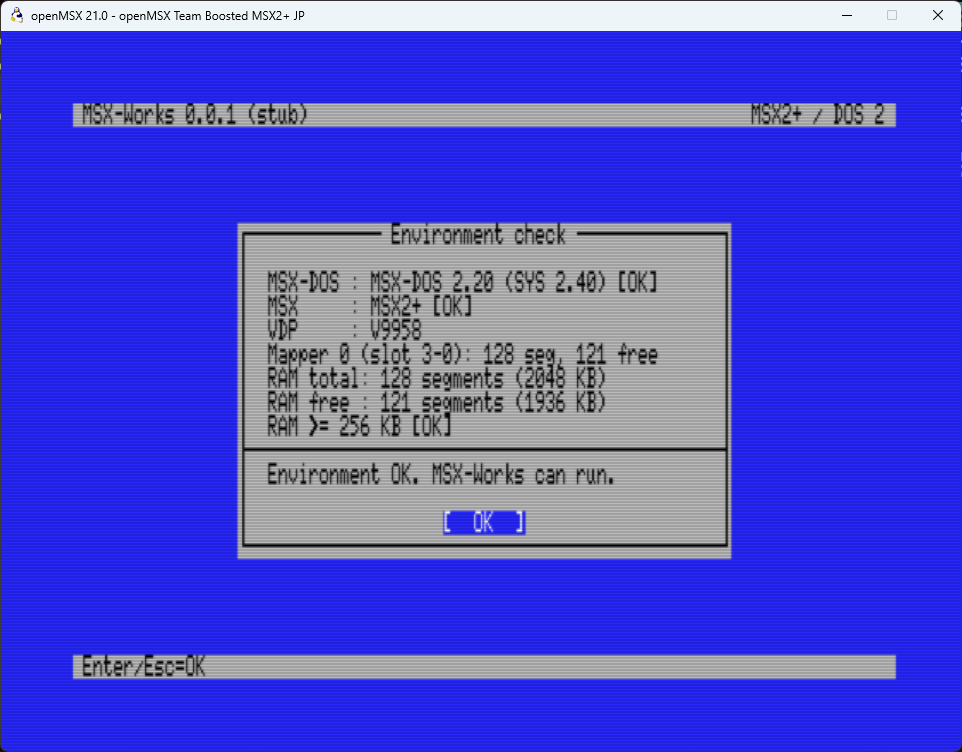
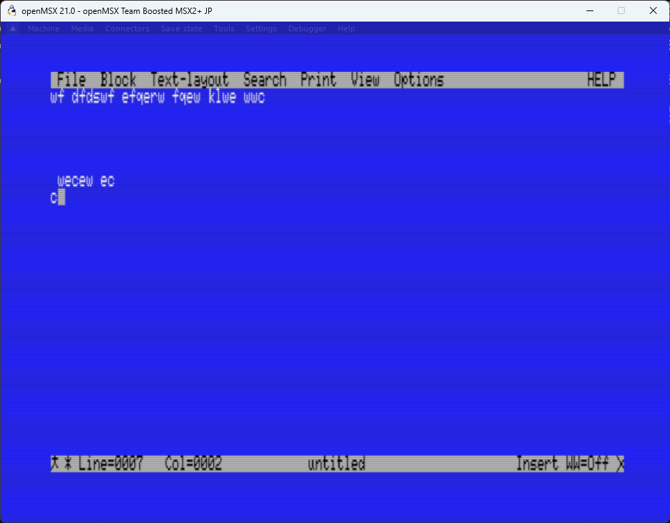

# MSX-Works

MSX-Works é um projeto de ambiente integrado de produtividade para **MSX2+ e MSX-DOS 2**, com interface de texto em 80 colunas e menus operados pelo teclado.

O programa inicia sempre como **editor de textos**. A proposta é desenvolver esse editor tomando o **Norton Editor 2.0 como referência de funcionalidades**, e depois permitir escolher, pelo menu, um processador de textos, uma planilha e um banco de dados. A compatibilidade completa com o editor de referência é um objetivo, não uma funcionalidade já concluída.

## Requisitos

- MSX2+ ou superior compatível.
- MSX-DOS 2.
- Pelo menos 256 KB de RAM com mapper.

Na inicialização, o programa verifica o ambiente e apresenta um relatório. A memória livre para documentos depende das reservas do DOS e do sistema, não apenas da RAM instalada.



## O que já funciona

- Editor como modo padrão, com inserção, sobrescrita, Enter, Tab, Backspace e Delete.
- Navegação por caracteres, linhas, palavras e início/fim do documento.
- Barra de menus: `File`, `Block`, `Text-layout`, `Search`, `Print`, `View`, `Options` e `HELP`.
- Menus abertos com `SELECT` e navegados pelas setas.
- Barra de status com indicador de alteração, linha, coluna, nome do documento, modo de digitação e Word Wrap.
- Word Wrap visual, desligado por padrão.
- Documento armazenado nos segmentos livres do mapper do DOS 2, inclusive em diferentes slots, sem o antigo limite de 8 KB.
- Atualização incremental da tela, sem limpar toda a área de texto a cada tecla.
- Confirmação antes de descartar um texto alterado ao sair.



As imagens mostram capturas de desenvolvimento no openMSX; os valores de memória variam conforme a máquina.

## Estado atual e próximos objetivos

O projeto ainda é um protótipo. **Abrir e salvar arquivos não está implementado: o texto permanece apenas na RAM e é perdido ao sair.**

Seleção de blocos, busca, impressão e os outros modos de aplicação também estão pendentes. As opções de modos futuros já aparecem em `View`, mas exibem um aviso e mantêm o editor ativo.

Consulte:

- [Manual e teclas de atalho](manual.md).
- [Ponto de parada e próximos passos](outline.md).

## Compilação

O código usa [MSXgl](https://github.com/aoineko-fr/MSXgl) e SDCC. Na estrutura atual, a pasta `MSXgl` fica ao lado da pasta `msxworks`.

Em um terminal PowerShell no Windows, a partir da raiz do repositório:

```powershell
.\msxworks\build.bat all
```

O script usa as ferramentas fornecidas pelo MSXgl. Se a biblioteca estiver em outro local, configure `MSXGL_PATH` antes de executar o build.

Saídas principais:

- `msxworks\out\msxworks.com`: executável DOS 2.
- `msxworks\emul\dsk\DOS2_msxworks.dsk`: imagem de disco gerada para testes.

Para executar no MSX-DOS 2, use `MSXWORKS`. Para testes no openMSX, utilize uma máquina compatível e monte o disco gerado. ROMs, arquivos do DOS e ferramentas de terceiros estão sujeitos às respectivas licenças.

## Testes

Há testes locais em C para edição e armazenamento, e scripts Tcl para o openMSX:

- [editor_test.c](msxworks/tests/editor_test.c): operações de edição, mapper e comparação entre atualização incremental e redesenho completo.
- [editor_ui.tcl](msxworks/tests/editor_ui.tcl): teclado, menus, navegação e status.
- [editor_memory.tcl](msxworks/tests/editor_memory.tcl): documentos grandes, tráfego de VRAM e liberação de memória.
- [editor_speed.tcl](msxworks/tests/editor_speed.tcl): sequência rápida de caracteres, ordem de entrada e tempo de processamento.

## Licença

O código original do MSX-Works é disponibilizado sob a **GNU General Public License, versão 3 (GPL-3.0-only)**. O texto completo está em [LICENSE](LICENSE).

Isso não altera as licenças de componentes de terceiros. O MSXgl, de Guillaume “Aoineko” Blanchard, inclui sua própria [licença CC BY-SA 4.0](MSXgl/LICENSE.md); suas ferramentas e outros materiais podem ter licenças específicas.
